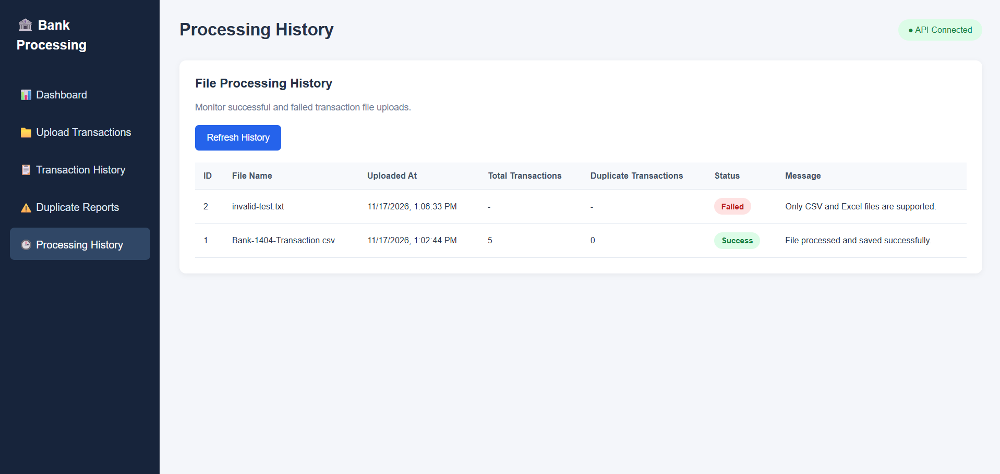

# 🏦 Bank Transaction Processing System

A Python-based Bank Transaction Processing System that validates, processes, and manages bank transaction files using **FastAPI, PostgreSQL, Pandas, and a web-based dashboard**.

The application supports CSV and Excel uploads, transaction validation, duplicate detection, database storage, processing history, and transaction reporting through an integrated web dashboard.

## 🚀 Features

- **Transaction File Upload:** Upload CSV and Excel transaction files.
- **Data Validation:** Validate required transaction columns and data.
- **Duplicate Detection:** Identify duplicate transactions using Transaction ID.
- **Duplicate Reports:** Generate downloadable duplicate transaction reports.
- **PostgreSQL Integration:** Store processed transactions in a relational database.
- **REST API:** Manage transaction uploads and retrieve transaction records using FastAPI.
- **Integrated Dashboard:** Access the frontend dashboard directly through the FastAPI application.
- **Transaction History:** View previously processed transactions.
- **Processing History:** Track successful and failed file uploads.
- **Logging:** Maintain separate bank and credit transaction logs.
- **Automated Testing:** Verify application functionality using pytest.

## 📸 Application Screenshots

### Dashboard


### Processing History



## 🛠️ Technologies Used

| Technology | Purpose |
|---|---|
| Python 3.12 | Backend development |
| FastAPI | REST API development |
| Pandas | Data processing and analysis |
| PostgreSQL | Database management |
| SQLAlchemy | Database ORM |
| OpenPyXL | Excel file handling |
| HTML, CSS, JavaScript | Frontend dashboard |
| Pytest | Automated testing |
| Git & GitHub | Version control |

## 📂 Project Structure

```text
bank-transaction-processing-system/
│
├── app/
│   ├── __init__.py
│   ├── api.py
│   ├── database.py
│   ├── models.py
│   ├── processor.py
│   └── validator.py
│
├── frontend/
│   └── index.html
│
├── tests/
│   ├── test_api.py
│   ├── test_processor.py
│   └── test_validator.py
│
├── screenshots/
│   ├── dashboard.png
│   └── processing-history.png
│
├── input_file/
├── duplicate_reports/
├── Log/
│
├── main.py
├── pytest.ini
├── requirements.txt
└── .gitignore
```

## ⚙️ Installation and Setup

### 1. Clone the repository

```bash
git clone https://github.com/shakthimallesh2001/bank-transaction-processing-system.git
```

### 2. Navigate to the project directory

```bash
cd bank-transaction-processing-system
```

### 3. Create a virtual environment

```bash
python -m venv .venv
```

### 4. Activate the virtual environment

For Windows PowerShell:

```powershell
.\.venv\Scripts\Activate.ps1
```

### 5. Install dependencies

```bash
python -m pip install -r requirements.txt
```

## 🗄️ Database Configuration

This project uses PostgreSQL for transaction storage.

1. Install PostgreSQL.
2. Create a database named `bank_transactions`.
3. Create a `.env` file in the project root directory.
4. Configure the database connection:

```env
DB_HOST=localhost
DB_PORT=5432
DB_NAME=bank_transactions
DB_USER=postgres
DB_PASSWORD=your_postgres_password
```

Replace the password with your own PostgreSQL password.

**Security:** Never upload your `.env` file or database credentials to GitHub. The `.env` file should remain excluded through `.gitignore`.

## ▶️ Running the Application

### 1. Activate the virtual environment

```powershell
.\.venv\Scripts\Activate.ps1
```

### 2. Start the FastAPI application

```bash
python -m uvicorn app.api:app --reload
```

### 3. Open the integrated dashboard

Once the server starts, open:

**Dashboard:** http://127.0.0.1:8000/

The integrated dashboard provides access to:

- Dashboard
- Upload Transactions
- Transaction History
- Duplicate Reports
- Processing History

The frontend is served directly by FastAPI. A separate frontend development server is not required.

### 4. Access API documentation

FastAPI provides interactive API documentation through Swagger UI.

**Swagger Documentation:** http://127.0.0.1:8000/docs

**OpenAPI Schema:** http://127.0.0.1:8000/openapi.json

### 5. Run the original file-processing application

Place transaction files inside the `input_file` directory and execute:

```bash
python main.py
```

## 🔗 API Endpoints

| Method | Endpoint | Description |
|---|---|---|
| GET | `/` | Serve the integrated dashboard |
| GET | `/health` | Check API health |
| GET | `/transactions` | Retrieve transaction records |
| GET | `/processing-history` | Retrieve file processing history |
| POST | `/upload` | Upload and process transaction files |

## 🧪 Running Automated Tests

Run the complete test suite using:

```bash
python -m pytest -v
```

### Test Results

**22 tests passed successfully.**

The automated tests cover:

- API endpoints
- CSV file uploads
- Duplicate transaction detection
- Database storage
- File validation
- Processing history
- Transaction processing

## 🏗️ Application Architecture

The application consists of three main layers:

**1. Frontend**

A web-based dashboard developed using HTML, CSS, and JavaScript. It allows users to upload transaction files, view transaction statistics, monitor transaction history, and access duplicate and processing reports.

**2. Backend**

A FastAPI application responsible for handling file uploads, validating transaction data, detecting duplicates, processing files, and providing REST API endpoints.

**3. Database**

PostgreSQL stores transaction records and file processing history. SQLAlchemy is used for database operations and ORM management.

## 🔮 Future Enhancements

- Cloud deployment
- User authentication and authorization
- Advanced transaction analytics
- Improved error monitoring
- Real-time processing notifications

## 👩‍💻 Author

**Shakthi D**

GitHub: [https://github.com/shakthimallesh2001](https://github.com/shakthimallesh2001)

**Project Repository:** [Bank Transaction Processing System](https://github.com/shakthimallesh2001/bank-transaction-processing-system)

⭐ If you find this project interesting, feel free to explore the repository!